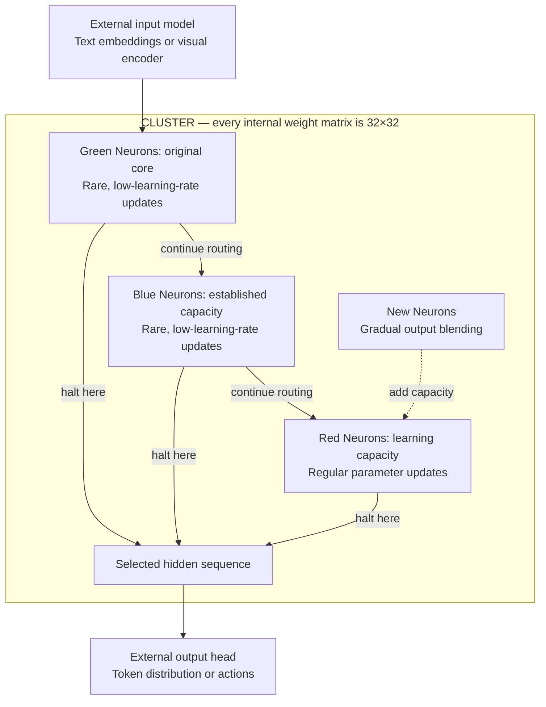
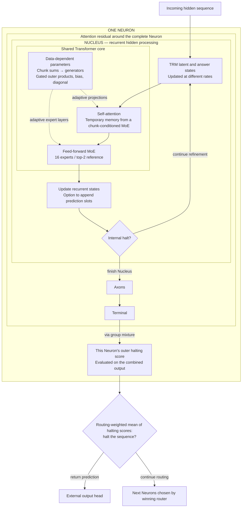

# Neuron Cluster Model

Living design summary. Created: 2026-09-19. Last updated: 2026-09-20.

## Features at a glance

Intended feature set; implementation status and unresolved choices are described below.
The Cluster contains Neurons; each Neuron contains a Nucleus, Axons, and Terminal.
**Internal halting ends reasoning inside a Nucleus; external Neuron-level halting
can end the route through the Cluster.** These are separate mechanisms.
Likewise, the Nucleus's recurrent attention-residual history stays inside that
Nucleus. The outer history contains combined Neuron outputs from routing rounds;
it does not contain the Nuclei's internal histories.

### Nucleus — processing inside one Neuron

- **Recurrent control around the Transformer**

  - Two-state TRM latent reasoning, repeatedly applying the same Transformer core to update latent and answer states at different rates.
  - Internal learned halting that ends Nucleus refinement, with a ponder-cost loss in the reference configuration.
  - Internal attention residual across recurrent steps, with history private to the Nucleus; its exact integration with the two-state TRM schedule remains to be defined.
  - A proposed controller that adds zero-initialized prediction slots during recurrence; later passes refine the expanded sequence in parallel.

- **Transformer model — the computation reused by TRM**

  - **Self-attention sublayer**

    - Multi-head self-attention; reference four heads with expert query/output projections and dense shared keys/values.
    - Configured adaptive projections and expert linear layers use the data-dependent parameter mechanism described below.
    - Internal attention memory: a separate MoE transforms summed chunk representations into temporary memory tokens.
    - Memory tokens join the current sequence before Q/K/V projection; their output positions are discarded after attention output projection.
    - Persistent memory ownership, write/update rules, and reset behavior remain to be defined.

  - **Feed-forward sublayer**

    - A mixture of experts transforms token representations; reference 16 experts, top-k 2, and hidden width 32.
    - Adaptive linear layers inside the experts use generated weights, biases, and diagonal terms.
    - Expert routing selects local transformations; it is separate from routing between whole Neurons in the Cluster.

  - **Data-dependent parameters — inside the adaptive linear layers of these sublayers**

    - **Generation context:** split the layer's input sequence into chunks and sum each chunk's own token vectors.
    - **Shared application:** generate one parameter set per chunk, apply it to each original token in that chunk, and preserve token order and sequence length.
    - **Weight generator:** the DualModel reference uses two learned networks to generate vector factors whose outer products are summed into a weight update.
    - **Component gates:** proposed chunk-conditioned gates select contributions from a bounded number of outer products; the example maximum of ten is not fixed.
    - **Bias and diagonal generators:** predict additional adaptive bias and diagonal adjustments from the generation context.
    - **Parameter controls:** soft clamping and adaptive decay govern the generated update and the retained base parameters in the reference design.
    - **Generator choice:** DualModel remains the reference; diagonally modulated low rank is an assistant recommendation for gating, not a selected replacement.
    - **Growing inputs:** regenerate affected chunk parameters as available context changes; partial-chunk timing and cache handling remain open.

  - **Other Transformer components**

    - Within-block residual connections, normalization, and dropout; the reference has one physical decoder block with dropout 0.1.
    - Soft MoE is a candidate replacement for expert mixtures; exact roles and settings remain undecided.

- **Nucleus output:** the processed hidden sequence, including any added prediction positions, passes onward through the Neuron and Cluster; the Nucleus's internal residual-history list stays inside it.

The parameter generators are learned models inside the adaptive transformations.
They generate parameters for the receiving linear layer; the attention-memory
generator produces extra representations instead. Memory slots and prediction
positions therefore remain separate from the generated weights.

### Neuron — wrapper around Nucleus, Axons, and Terminal

- A Neuron may learn several skills; its input-dependent output tensors are the "opinions" that later Neurons can reuse.
- Each Neuron owns its learned attention-residual parameters, separate from its Nucleus residuals; sequences carry one shared history, with one weighted mixed sequence appended per routing round.
- All top-K selected Neurons use their own residuals against the same history for that step; combine their resulting outputs and append only that weighted mixture.
- Its own external halting mechanism evaluates the combined top-K output and contributes a score to the group's stop decision, separate from the Nucleus's internal halting.
- The aggregate halt decision can return the mixed hidden representation for prediction; continuing permits further routing.
- An ordered hidden-sequence interface that carries existing and newly added prediction positions between Neurons.

### Cluster — routing, growth, and learning schedules

- Spatial mixture of experts: choose top-K Neurons once per whole sequence; selected Neurons process that sequence and their outputs form a probability-weighted sum.
- The Neuron with the highest selection probability controls onward routing through its own router; the combined representation continues, retaining the other selected Neurons' contributions.
- Each selected Neuron judges the same combined output; their halting scores form a sequence-level mean using routing probabilities normalized over the top-K group.
- Different sequences can select different Neurons and traversal depths; tokens and chunks within a sequence do not receive separate Cluster routes.
- Sequence-level halting preserves each completed output in its original batch/sample position while other sequences continue, keeping predictions aligned with labels.
- Capacity growth by adding Neurons, distinct from adding latent prediction positions inside a Nucleus.
- Gradual introduction of new Neurons by blending their outputs with the previous representation.
- Regular training for red Neurons; blue and green Neurons frozen between rare, low-learning-rate updates.
- Per-Neuron processed-signal counters controlling update eligibility, with 1,000 signals as an illustrative interval.
- Candidate feedback-driven update priorities and experience/agreement checks for readiness; these policies remain undecided.
- Routes that halt in a stable region before reaching red can return predictions without an ordinary learning update.
- Specialized regions and shorter routes for frequently needed skills, with exact placement and incentives still open.
- Continual online learning with a bounded resident capacity for the single-GPU goal.

### Outside the Cluster — input, output, and task objective

- Contextual input embedding model producing the hidden sequence supplied to the Cluster.
- External vocabulary head mapping each final prediction position from 32 features to V token scores.
- Variable-length prediction/target alignment, masking, and loss reduction for the added prediction positions.
- Task loss and aggregation of internal auxiliary losses, with routing losses reconsidered if Soft MoE is selected.
- Initial language-model evaluation on WikiText-2, with a longer-term multimodal/RL direction.
- Candidate image-first setup with patch embeddings; future video/audio inputs and external action outputs for interaction with a small robot.

### Between Clusters — learning on two computers

- Alpha and Omega: two independent Clusters, one on each computer, cooperating and teaching each other.
- Intended latent-space communication; message alignment, the learning objective, and how received knowledge persists remain undecided.

### Shared constraints and conventions

- Every weight matrix inside the Cluster, including Neuron wrappers and Nuclei, constrained to 32×32; external input/output layers are exempt.
- Monitoring injected through external hooks or wrappers, including for Nucleus memory.
- Attention-memory slots, recurrent states, and persistent prediction positions have distinct roles and lifetimes.

## Requirements still to implement or fix

Checked against the current working tree on 2026-09-19. Core experts, adaptive
parameters, recurrence, learned halting, fixed-length sequence routing, and
injected memory monitoring already exist. The remaining requirements are:

- **Integration:** Complete the GPT Cluster model with external contextual embeddings, vocabulary head, data/target handling, and model-package registration.
- **Matrix dimensions:** Ensure every internal weight matrix is 32×32, including generators, routers, memory, and control heads; hidden width 32 alone does not establish compliance.
- **Configuration:** Reconcile the copied GPT defaults with the contextual-embedding options; the current parity test fails on four missing options.
- **TRM configuration:** Set explicit latent/answer update counts and initialization; integrate the required internal attention residual with those phases while keeping its history private to the Nucleus.
- **Neuron wrapper:** Apply each selected Neuron's own residual against the same history snapshot, then append only their weighted mixed output; separate branch reads from history mutation and define read placement, retention, alignment, and interaction with variable sequence lengths.
- **Soft MoE candidate:** Choose its variant and scope, slot budget, masking, and adaptive-parameter integration; ordinary full routing is not the published slot-based Soft MoE.
- **Adaptive rank gates:** Define chunk-conditioned component gates, exact-zero behavior, and training incentives; build on the existing rank-coefficient generator where appropriate.
- **Unsupported combination:** Enable the intended whole-chunk parameter sharing in the chosen GPT design; current causal and explicitly masked paths reject it.
- **Chunk layout:** Preserve example/token identity through expert routing; support growing lengths, partial chunks, padding, and inference-time parameter regeneration with valid caches.
- **Missing memory path:** Generate attention memory from summed current chunks through a MoE; the existing slot reader uses a learned fixed query.
- **Memory learning:** Specify the memory objective, per-Neuron ownership, and any persistent-state, update, forgetting, and reset rules.
- **Online update schedule:** Train red Neurons normally and gate blue/green parameter updates by configurable per-Neuron signal intervals; define counter units, update data, optimizer behavior, and the scope across generators, memory, and routers.
- **Halting and updates:** Return predictions without ordinary learning updates when a route halts in the stable region before reaching red Neurons; retain rare blue/green updates and define controller, external-head, and mixed-route behavior. Specify feedback for premature halts and distinguish experience/agreement checks from measured prediction quality.
- **Skill retention:** Preserve useful processing paths as shared modules change; combine the selected freeze/update policy with explicit treatment of routing, encoders, outputs, and persistent memory.
- **Learning signal:** Choose an objective; screen-based reinforcement learning is a possibility, with rewards, actions, and credit assignment still undefined.
- **Peer teaching:** Define Alpha/Omega's latent message interface, how its meaning stays aligned as both learn, how useful messages become retained knowledge, and how improvement is checked against task outcomes.
- **Capacity growth:** Define when new Neurons are useful and how they are initialized and trained; current growth uses usage thresholds and runs only in training mode.
- **Neuron warm-up:** Set the blend schedule and training opportunities; align its counter with the intended Neuron processing steps, since the existing countdown advances on every training Cluster forward, including unvisited Neurons.
- **Single-GPU budget:** Bound resident Cluster growth and account for weights, optimizer state, generated parameters, recurrent activations, and memory; indefinite growth cannot fit a fixed device budget.
- **Placement and routing:** Arrange stable and trainable regions so traversal depth and halting can control access to red learning capacity; resolve placement and routing incentives, since current growth places near the saturated Neuron.
- **Sequence routing:** Replace the current token-row Cluster routing with one top-K selection, winning router, and active/halting state per sequence; preserve original sample and token identity through dispatch, early exits, and final output assembly. Sequence-summary/scoring details remain open.
- **Spatial mixture contracts:** Set Cluster-level K; align branch outputs when prediction lengths grow, append their weighted mixture as one residual-history entry per round, and resolve halting/update eligibility when selected branches have different training states.
- **Multimodal boundaries:** Specify external image/video/audio encoders, spatial and temporal identity, action outputs, and observation/action/feedback alignment for the proposed embodied direction.
- **Missing growth controller:** Learn whether and how many prediction slots to append during recurrence, with a defined length budget and training signal.
- **Fixed-shape contracts:** Extend the Nucleus/Cluster interfaces and align TRM input, latent/answer states, routing, masks, positions, residual histories, and halting when slots are added.
- **Prediction loss:** Align active added slots with the correct future-token labels, exclude inactive/padded positions, and define loss reduction across variable lengths.
- **Generation behavior:** Define how parallel slot predictions are refined, accepted, and stopped, including end-of-sequence handling.
- **Information access:** Define training and prefix-only evaluation boundaries for every memory/parameter path; accepted training leakage must not be mistaken for causal generation quality.
- **Memory correctness:** Fix the memory/relative-position interaction that changes valid-token outputs when padding or sequence length changes.
- **Memory parameter ownership:** Avoid unused legacy projection/gate networks in slot mode; these cause the previously reproduced default distributed-training failure.
- **Early validation:** Reject invalid persistent-memory settings before allocating parameters and consuming random-number state.
- **Contract coverage:** Reconcile the attention schema/fixtures and register the new production modules and memory tests in the normal family checks.

The focused recheck passed 51 tests and 1,609 subtests, with two failed tests and
four failed configuration-parity subtests. Diagnostic probes reproduced the
relative-position defect, unused memory networks, and late-validation issue;
they also confirmed that the earlier monitoring fix now reports memory metrics.
The distributed failure was reproduced in the earlier review and was not rerun
in this recheck. These checks cover local mechanics, not training quality.

## Architecture overview

These diagrams show the intended design, including features still to implement.
The first shows one illustrative route, not a fixed topology or Neuron count.
Each routing round may execute several top-K Neurons and combine their outputs;
the single continuation shown follows the highest-weight Neuron's router.
The stop decision combines the selected Neurons' outer halting scores.

### One Cluster and its external interfaces

Each visited Neuron can end the route. Halting before reaching red capacity can
return a prediction without an ordinary learning update. Blue/green maintenance
updates remain separately controlled by each Neuron's signal counter; 1,000
signals is an example interval. Alpha and Omega would run on separate computers,
with latent communication and reciprocal teaching through a protocol still to be
defined.

### Inside one Neuron

The enclosing residual box identifies its scope: each selected Neuron reads the
same history using its own residual parameters before the branch outputs are
combined. Only their weighted mixture is added to the continuing history. Read
placement relative to the Nucleus, history retention, and alignment remain open.
The diagram likewise leaves the precise timing of
prediction-slot creation within the TRM schedule open. The two halt decisions
control different loops and do not themselves define optimizer eligibility.

- **Adaptive parameters:** each receiving layer summarizes its own input chunks.
  For example, 35 tokens split into seven chunks of five produce seven parameter
  sets, each applied to its five original tokens. The dashed edges show this
  conditioning mechanism, not one shared generated matrix for every layer.
- **Attention memory:** a separate generator turns chunk sums into temporary
  memory tokens. They join the sequence before Q/K/V projection and are removed
  after attention output projection; their contribution remains in token outputs.
- **Prediction slots:** appended latent positions survive the Nucleus and Cluster
  and reach the external output head. The example 35 → 40 positions adds five
  prediction positions; it is separate from temporary attention memory.
- **Candidate choice:** Soft MoE could replace selected expert mixtures; its use
  is not yet decided. Persistent memory update rules are also still open.

Keep an end-to-end design check alongside the selected low-to-high-level approach:
trace one input through an early halt in blue and a continuation into red, then
specify what feedback teaches each halting decision and which parameters may
change. The response to an incorrect early prediction remains a design question,
not a selected training rule or an implementation request.

## Purpose and constraints

Keep the architecture, useful reference values, confirmed requirements, and main
open questions needed to resume this conversation. This is a collection of ideas,
not an implementation plan or a transcript. Keep future updates at summary level
and omit experiment names and study references.

Keep the grouped **Features at a glance** synchronized with substantive decisions
and clarifications in our conversations. Place each feature at its correct level,
show parent/child structure within each level, distinguish confirmed requirements
from candidates and open choices, and revise superseded descriptions rather than
accumulating contradictory versions.

The user currently lacks compute to train and compare the complete model.
Discussion should offer reasoned architectural opinions and identify uncertainty
without requiring a large evaluation campaign. Only this document is being
updated; no model code changes are requested.

The user prefers starting with the full, flexible architecture and reducing
complexity as its mechanisms become better understood. A large series of small
training experiments is not a practical prerequisite for this discussion.
The user explicitly prefers designing from low level to high level: clarify the
adaptive transformations, then the Nucleus, the complete Neuron, and the Cluster,
while retaining the overall learning goal and resource constraints.

The user requests an active design interview using the grill-me approach: ask one
question at a time, include an assistant recommendation, and resolve dependent
choices through conversation. Inspect existing code for factual implementation
questions. Keep these notes synchronized with confirmed answers and preserve the
distinction between user decisions, assistant suggestions, and open questions.

**Every weight matrix inside the Cluster must be 32×32.** This includes Nucleus
transformations, parameter generators, routers, memory, and control heads.
External input embeddings/encoders and output heads are outside this constraint.
Internal projections must be checked explicitly; hidden width 32 alone does not
establish that all stored and generated weight matrices satisfy the requirement.

The user estimates the current language model at roughly six million parameters
with 16 experts and no attention memory enabled. Memory overhead and the complete
Cluster budget remain unspecified; parameter count alone omits generated-weight
activations, repeated passes, and online-update compute.

The long-term aspiration is broad capability comparable to GPT-6 while fitting
the model on a single GPU. The user explicitly treats this as an unsupported
hypothesis. GPU capacity, acceptable latency, and the training budget are not yet
specified; fitting the model and learning the desired capabilities are separate
constraints. Continual growth needs a limit on resident capacity or an explicit
storage/retirement policy to preserve the single-GPU target.

The user reports perplexity around 300 after approximately 11 hours of the current
language-model experiment. This is an unverified progress report; the data split
and metric history are not yet established here. It does not evaluate proposed
features absent from that run or establish broad capability.

## Confirmed direction

- Use a spatial mixture at Cluster level: selected Neurons process the same routed
  input, their outputs are combined with routing weights, and the highest-weight
  Neuron's own router determines subsequent destinations for the combined result.
  Top-K selection is per whole sequence, distinct from the expert mixtures and
  adaptive parameter chunks inside each Nucleus. Different sequences may follow
  different routes and halt at different depths. Completed sequences retain their
  original batch/sample positions so their outputs still match their labels.
- Keep one attention-residual history per sequence. Append the weighted mixed
  sequence from each routing round as one entry; do not retain the individual
  selected branch outputs as separate history entries. This combines output
  representations without removing model parameters.
- Give each Neuron its own learned attention-residual parameters. The history is
  carried with the sequence; its readers' parameters belong to individual Neurons.
  Every top-K selected Neuron uses its own residual against the history available
  at the start of the round. Their resulting outputs are combined, and only that
  weighted mixture is appended to the history passed onward. This requires K
  residual computations with one continuing history per sequence. Placement of
  each residual relative to its Neuron's processing remains open.
- Combine all selected Neurons' outer halting scores into a sequence-level mean
  using the same routing probabilities, normalized over the selected group.
  Each selected Neuron's own halting mechanism evaluates the combined output.
  Winner-only halting is not selected; the highest-weight Neuron still controls
  onward routing when processing continues.
- Build a Cluster of Neurons whose Nuclei contain GPT-style hidden processing
  cores: attention, adaptive experts, internal attention memory, latent recurrence,
  residuals, and their own internal learned halting.
- Keep the attention-residual history of a Nucleus's recurrent steps inside that
  Nucleus. Its returned hidden representation can reflect that history, but the
  list itself is not exported into the separate outer Neuron history. Internal
  attention residuals are intended; their exact TRM phase placement remains open.
- Each complete Neuron contains Nucleus, Axons, and Terminal, surrounded by an
  attention residual over earlier Neuron outputs and a halting mechanism. After
  the selected Neurons process a signal, their halting mechanisms judge the mixed
  result. The aggregate decision can return it to the external prediction head or
  allow further routing. Reaching an edge or a fixed final Neuron is not required.
  These outer wrappers are a confirmed requirement.
- Aim for a broadly reusable learner across environments and skills. The user's
  hypothesis is that input-conditioned transformations, memory, recurrence, and
  growing capacity can provide flexibility despite the small matrix constraint;
  broad generalization remains an objective, not an established capability.
- Use the existing TRM variant for inner reasoning: one shared transition updates
  latent and answer states on different schedules. Attention memory and parallel
  latent predictions are the other main priorities. Soft MoE remains a candidate.
- The long-term goal is continual learning: add Neurons during use and keep
  training. Red Neurons receive regular training updates; both blue and green
  Neurons remain frozen between rare updates at a very low learning rate,
  controlled by each Neuron's own processed-signal count. Adding Neurons expands
  model capacity; adding latent prediction slots expands an output horizon.
- Use halting at individual Neurons to stop Cluster traversal. A signal can stop
  in blue before reaching red, returning the existing prediction without an
  ordinary learning update. Continuing into red makes actively trainable capacity
  available. This is distinct from TRM recurrence and halting inside one Nucleus;
  the previously selected rare blue/green updates remain separate exceptions.
- Introduce each new Neuron gradually through a weighted sum of the previous
  representation and its new output. Start with a small contribution and increase
  it as the Neuron gains experience, analogous to introducing recurrent steps.
  Around 20,000 or 100,000 processing steps are examples, not a fixed schedule.
- Ordinary next-token modeling on WikiText-2 remains the initial evaluation
  direction. The broader goal includes multiple modalities and skills, potentially
  learned through reinforcement learning; its objective is not yet selected.
- The user is open to a first Cluster experiment with a fixed number of Neurons,
  preserving the intended Nucleus architecture before enabling capacity growth.
- Alpha and Omega are intended as independent Clusters on separate computers,
  cooperating through latent-space communication and reciprocal teaching. The
  communication and learning mechanisms remain undecided. Image patches are a
  possible first visual input, with video, audio, and small-robot control as future
  directions; no environment or embodied training objective is selected.
- Extend generation to multiple future tokens using new latent positions.
  Individual Neurons should be able to add zero-initialized embeddings, with a
  controller deciding during Nucleus recurrence whether and how many to add.
  Subsequent recurrent iterations process the expanded sequence. These positions
  persist through the Cluster and reach the external prediction head.
- Keep task input processing/embedding and the final prediction head outside the
  Cluster. Each Nucleus receives and returns an ordered hidden sequence.
  Attention projections and internal feed-forward layers remain inside it.
- The contextual input produces 32-dimensional token representations. After
  Cluster processing, an external vocabulary head maps each prediction position
  from 32 features to V logits, one for every token in the vocabulary. Softmax
  converts those scores into a probability distribution when needed; training
  passes logits directly to cross-entropy. A conventional dense 32→V head is
  exempt from the Cluster's 32×32 constraint and is separate from the contextual
  embedding, which has no vocabulary lookup matrix to tie to that head.
- **Adaptive chunk grouping must be enabled.** Before generating an adaptive
  linear layer's parameters, split its input sequence into chunks and sum each
  chunk's own representations. Generate one parameter set per summary and apply
  it to every original token in that same chunk, preserving the sequence length.
  Conditioning on an earlier chunk instead is not the requested behavior.
- Let the same chunk context determine which outer-product components contribute
  to its generated weight update. A maximum of ten components is the user's
  example; gate form and the final component budget remain open.
- The user's current preference is to retain the GPT-style core even with the
  resulting future-information leakage. Treat this as an experimental design
  with noncausal information paths; a BERT-style switch is not the current choice.
- Include attention memory generated by a separate mixture of experts, described
  below. Its exact settings and learning mechanism remain open.
- Preserve the monitoring convention: the monitoring class injects hooks or
  wrappers; memory configuration does not contain monitoring switches.

## Starting architecture values

These preserve the starting configuration for discussion. Information access
must be reconciled with the intended next-token task and same-chunk generation.
TRM is now the selected recurrence direction; earlier standard-recurrence values
are retained as reference only. Soft MoE settings have not been selected.

| Part | Reference values |
| --- | --- |
| Transformer core inside the Nucleus | Hidden width 32; reference input length 35; proposed variable latent length; one physical decoder block; dropout 0.1 |
| Attention | Four heads; query/key and value widths 32; expert query/output projections; dense K/V; no cross-attention |
| Attention direction | Keep the GPT-style core; full-chunk conditioning makes the complete model noncausal even if attention retains a causal mask |
| Experts | 16 per mixture; top-k 2; feed-forward width 32; expert bias enabled; normalized weighting after experts; capacity factor 0 |
| Routing losses | Switch 0.01; zero-centred 0.001 |
| Adaptive parameters | Dual-model reference with generated bias and combined dynamic diagonal; weight-entry masking disabled; input-dependent rank-component gating is now desired |
| Parameter generator | Width 32, two stack layers; reference outer-product component count 5; proposed gated maximum 10 is illustrative and distinct from network depth |
| Dynamic-weight controls | SOFT_CLAMP before outer product; exponential adaptive decay 0.0001; warmup 5,000 batches |
| Chunk grouping | Enabled as a requirement; sum reduction; one generated set per chunk; final chunk size/count open |
| Nucleus recurrence | Internal TRM selected; latent updates per answer update, answer update count, and initialization scale remain to be chosen |
| Nucleus memory | Internal attention memory generated from summed chunks through a separate MoE; slot counts, expert settings, and persistence/update rules remain open |
| Neuron wrapper | Nucleus/Axons/Terminal enclosed by attention residual and halting; each Neuron owns its residual parameters; one mixed-sequence history entry per routing round; read placement and retention remain open |
| Earlier recurrence reference | Standard recurrence: initial/minimum 2, maximum 10; smooth growth by 1 per 20,000 forward calls; all-gradient transitions, no-gradient count 0; these are not TRM phase-count defaults |
| Nucleus residuals | Additive within-block reference; recurrent attention residual with private internal history is required, exact TRM integration open; earlier reference used block size 1 and RMS epsilon 0.000001 |
| Nucleus halting | Internal recurrence stopping; reference StickBreaking, threshold 0.999, RAW hidden state, ponder weight 0.01 |
| Neuron halting | Separate external stop/continue decision for Cluster traversal; no automatic inheritance of the Nucleus's halting settings |
| External contextual embedding | Four UTF-8 bytes per token; byte expert dimensions 36→32→32; context expert dimensions 64→32→32; independent 16-expert/top-k-2 mixtures |
| Embedding context | Learned absolute positions once; one-head causal inclusive prefix kernel, width 32; concatenate draft/context; learned correction scale starts at 0.001 |
| External output | Untied dense 32→V vocabulary head, outside the matrix-size constraint; reference V=28,782; one logit per vocabulary token per prediction position; final LayerNorm placement remains open |
| Optimization reference | Adam, learning rate 0.001, no scheduler, batch 16, float32, norm clipping 1.0 |

The parameter-generator settings are distinct from the proposed memory-generator
settings. Inner recurrence is also separate from traversal between Neurons.
A change to bidirectional processing may require revisiting the contextual
embedding and task boundaries as well as attention.

Assistant concern: a fixed linear 32→V vocabulary head restricts the logit
vectors to an affine space of dimension at most 32, regardless of the complexity
of the preceding Cluster. This is related to the
[softmax bottleneck](https://arxiv.org/abs/1711.03953). A more expressive external
readout is worth considering within the existing boundary exemption; no head
change is selected, and this is not evidence that the bottleneck dominates the
current loss.

## Input-dependent rank components

The current dual-model generator produces input/output vectors for each configured
component, forms their outer products, and sums them into an update added to the
decayed base weights. The setting called generator depth counts these components;
it is separate from the number of layers in each generator network.

The user wants a bounded bank of generated components, for example ten, with
one input-dependent gate per component predicted from the same summed chunk.
The intended update is `ΔW(s) = Σ_i g_i(s) u_i(s) v_i(s)ᵀ`, shared by that chunk's
tokens. Zero gates remove components. With factorized outer products, k nonzero
terms give rank at most k, not necessarily exactly k; the base weights and separate
dynamic diagonal mean this is not a rank bound on the complete transformation.

The existing `DiagonallyModulatedLowRankDynamicWeight` already predicts per-context
component coefficients and supports two generated factors. It is a close building
block, but the desired gate range, exact sparsity, and incentive to use fewer
components are not selected. These are rank-component gates, distinct from the
existing row/column or weight-entry masks and from TRM update counts.

The user chose DualModel as a tentative starting point and has not settled which
weight-generator variant best fits the model. Assistant recommendation for the
rank-gated direction: the diagonally modulated low-rank variant with both factors
generated from context. It preserves the two-generator idea and adds the required
per-component coefficients. This is a structural fit, not measured superiority;
DualModel remains the reference, and no configuration change is selected yet.

| Generator family | Relevant tradeoff in the current implementation |
| --- | --- |
| Single model | Reuses the same vectors on both sides of each outer product, restricting the form of the update. |
| Dual model | Generates both factors independently; sums a configured number of components without explicit component gates. |
| Low rank | Generates two factors and multiplies them directly, avoiding the explicit tensor of per-component outer-product matrices. |
| Diagonally modulated low rank | Adds input-dependent component coefficients; closest fit to the proposed rank gates. Generated or shared factors are supported. |
| Hypernetwork | Generates every matrix entry for each depth component; a larger generator output to budget for. |
| Layered/soft weighted banks | Mix learned bank entries; different constraints on the possible updates and additional bank storage. |
| Matrix weights mixture | Routes among complete learned matrices; introduces a matrix-bank selection problem rather than rank-component selection. |

Shared factors with only generated coefficients could reduce factor-generation
work, but restrict input-dependent directions; this is an alternative, not the
user's selected design. Chunk grouping is a separate concern for every family:
changing generators alone does not fix per-token generation or causal restrictions.

Gate a completed factor or outer-product contribution after transformations that
could recreate nonzero values; zeroing only the generator input is insufficient
when biases are present. Soft weights do not necessarily select an exact count.
Computing all components and masking afterward changes their contribution without
automatically saving generation compute. More active components permit a richer
weight update, but do not by themselves ensure better predictions.

## Spatial mixture and Neuron routing

The user clarifies that the Cluster itself is a spatial mixture of experts.
For one routing round, selected Neurons receive the common incoming representation
`h`, produce outputs `y_i = N_i(h)`, and form `y = sum_i p_i * y_i` using routing
probabilities. The highest-probability selected Neuron wins responsibility for
the next routing decision through its own router. The mixed representation
continues, so selecting one router does not discard the other Neurons' computed
contributions. Cluster-level K is not fixed by the inner MoE's top-k-2 reference.
The earlier assistant distinction between competing answers and complementary
contributions did not capture this execution rule and is not a selected policy.

Confirmed design: each sequence carries one attention-residual history, with one
weighted mixture `y` appended per routing round. Individual selected Neuron
outputs are not kept as separate history entries. Each entry remains a complete
sequence: mixing corresponding token positions across Neuron outputs does not
sum away the sequence dimension. This reduces history storage but prevents later
attention from independently reweighting those branch outputs. Neither storage
choice removes model parameters; selected trainable branches can receive task
gradients through the weighted mixture.

The user confirms that every selected Neuron uses its own learned
attention-residual parameters; these parameters are not shared across the Cluster.
Each branch reads the same history available at the start of the routing round.
Its output includes its own residual computation, then the selected outputs are
combined and their weighted mixture is appended once to the continuing history.
The winner controls onward routing, while all selected Neurons execute their
residuals. Individual branch outputs must not be appended to the common history
during these reads, which would expose different history to later-executed
branches. The timing of each read relative to Nucleus processing remains open.

The user selects whole-sequence routing: each sequence in a batch has its own
top-K destinations and winning router for that round. Its tokens/chunks travel
together through the Cluster. Different sequences may use different Neurons and
halt after different numbers of steps. Once a sequence halts, retain its final
representation at its original batch/sample position and stop further traversal
for that sequence while others continue. Preserve token/target alignment inside
each sequence as well; prediction-slot growth still needs its separate target
mapping. This specifies output identity, not detachment of the computation graph
or an additional optimizer policy.

For outer halting, the user's final choice is to combine the selected Neurons'
own scores so every selected Neuron contributes to the sequence's stop decision.
The user confirms using the routing probabilities normalized over the selected
group, so a Neuron with less routing weight has proportionally less influence
on halting.
The earlier recommendation to use only the winner's halting mechanism is not the
chosen policy. Winner-controlled onward routing remains unchanged, and this
aggregation does not replace internal Nucleus halting.

Confirmed design: average per-Neuron halting probabilities using the routing
weights normalized over the selected group,
`H = sum_i p_i * h_i / sum_i p_i`. If those weights already sum to one, their
weighted sum is already a weighted mean; no additional division by K is needed.
The user also confirms that each selected Neuron's halting mechanism reads the
same combined representation `y`, rather than just its own branch output:
`h_i = halt_i(y)`, followed by the weighted mean above. These are design decisions,
not implemented changes. Sequence reduction and how the aggregate enters the
halting lifecycle remain open. The current code uses a shared Cluster halting
model on the mixed representation rather than this per-Neuron score aggregation.

The current single-route implementation (`beam_width=1`) already forms this
weighted mixture and tracks the Neuron selected by `argmax` of the incoming
selection probabilities. Its router is then called with the combined hidden
representation; unused alternative departure routers are not evaluated merely
to discard their decisions. The weighted sum provides a gradient path through
selected trainable processing branches, while the discrete winner index itself
is not differentiable. It does not imply that every unused router receives a
task gradient on that step.

For sequence Nuclei, the current code chooses destinations per valid token row.
Each executed Nucleus receives the complete sequence context for its examples,
and selected token outputs are scattered into the mixture. This preserves full
sequence processing but is not one top-K choice for the entire sequence. The
user's selected sequence-level routing therefore requires a change to that
implementation. How a sequence is summarized for routing/halting scores remains
open. Aligning unequal generated lengths and resolving the halting-state lifecycle
and parameter-update rules also remain open.

## TRM and the Soft MoE candidate

The implemented TRM keeps a fixed input plus evolving latent and answer states.
The same transition processes input + answer + latent for latent updates, and
answer + latent for answer updates. The answer is the returned hidden sequence;
these updates need not decode vocabulary tokens. Exact update counts remain open.
This selects a recurrence schedule, not a substitute for residual connections.
The user's diagrams confirm an attention residual around each complete Neuron,
outside the Nucleus/Axons/Terminal components. That outer residual is required;
the user also confirms a separate internal attention residual across the
Nucleus's recurrent steps. Its history remains private to that Nucleus. Returning
a representation formed using that history does not export the history list.
The existing hidden-only backbone likewise returns the hidden sequence and loss,
not its decoder's residual state. Exact integration of the internal attention
residual with TRM's latent and answer updates remains open.
Variable-length prediction slots are still new work for both states.

There are two distinct decisions about processing depth: how much recurrent
refinement happens inside a Nucleus, and how many Neurons a signal visits in the
Cluster. The selected Neurons' halting wrappers judge the mixed representation,
and their routing-weighted aggregate can end the route at that step. The returned
hidden representation goes to the external task head; the diagrams do not imply
a separate vocabulary head inside every Neuron.
The user wants the outer attention residual to read earlier routing rounds'
weighted mixtures, so decisions can use more than the immediately preceding
output. Each round contributes one mixed sequence to the shared history.
The user calls these outputs "opinions": each Neuron applies its learned skills
to the signal and contributes a representation that later Neurons can select or
combine. These tensors expose knowledge expressed during that computation; they
do not provide direct access to every skill or fact encoded in the producer's
parameters. The term does not require a separate prediction head, human-readable
skill labels, or literal voting between Neurons.

The existing attention-residual building block matches the history-and-weighting
part of this description. With block size 1 it retains individual raw outputs
alongside the initial source; larger blocks sum consecutive outputs. A learned
query, or a query generated from the current output, scores normalized sources;
softmax weights mix the original source tensors. Whole-Neuron integration remains
a separate requirement. Routing selects further computation, while residual
attention selects among available computed contributions.

The existing residual forward also appends its current raw output to the supplied
state. Applying K such forwards to the same mutable state would violate the
selected one-entry-per-round policy. Integration must isolate each branch's read
and any temporary current-output source, then append only the final weighted
mixture to the continuing history. No source change is made by these notes.

History retention, alignment when positions grow, and
whether outer halting parameters are shared across Neurons remain to be specified.
This history is working state for computation; persistence across interactions
would require a separate lifetime policy. This does not merge
outer halting with the separate internal Nucleus mechanism. A learned decision
to stop is an estimate of readiness, not a guarantee of a correct prediction.

The user is considering Soft MoE for differentiable routing and to avoid expert
balancing losses. The published slot-based design pools token representations
into expert slots and combines the expert outputs back into token outputs. Its
balanced slot allocation avoids the usual load-balancing objective; this does
not eliminate the task loss or independently chosen memory/halting objectives.
Soft MoE's internal slots are separate from attention-memory and prediction slots.
Global pooling also mixes sequence positions, so its information-access policy
must fit the language-model task. It does not automatically implement the required
contiguous chunk sums for adaptive parameter generation. Variant, placement,
slot counts, and compute cost are undecided. The existing full-expert sampler is
a different execution strategy, not a verified implementation of this algorithm.

## Adaptive chunking and information access

The user's example is a sequence of 35 tokens split into seven chunks of five.
At the adaptive linear layer, sum each chunk's five input vectors element-wise
into one summary of the same hidden width. Generate seven parameter sets rather
than 35, then transform each chunk's original five vectors with its shared set:
35 input vectors → seven summaries → seven parameter sets → 35 output vectors.
Chunk size five is illustrative, not a fixed hyperparameter. This reduces
parameter-generation work; the end-to-end speedup still depends on grouping,
token transformations, and any recomputation.

Summation is an information bottleneck for the generator: distinct chunks with
the same summary receive the same parameters under the same generator state.
Contextual representations may encode order before summation, but preservation
of relevant distinctions is not guaranteed. The original token vectors remain
separate, so this does not imply identical final outputs for those chunks.

Each summary pools only its own chunk. Its input representations may already
encode earlier context from preceding processing, but other chunks are not
explicitly added to that summary. As the available sequence grows at inference,
allow affected summaries and parameters to be regenerated from the tokens then
available. Whether to update an incomplete chunk immediately or wait for more
tokens remains open. Reprocessing existing tokens also requires refreshing any
downstream cached representations that depend on them.

The first token's parameters therefore depend on the later four tokens. This
exposes future information through the adaptive transformation itself.
A causal attention mask cannot remove that dependency afterward. The existing
implementation explicitly rejects adaptive grouping with causal attention;
the sum operation exists, but this causal combination is unsupported.

The user considered a BERT-style direction, then expressed a preference to keep
the GPT-style architecture despite this dependency. Keeping GPT-style blocks or
a triangular attention mask does not make the overall computation causal when
the generated parameters or visible memory already contain future information.

Assistant assessment: for autoregressive generation, accepting this leakage is
not recommended. Ordinary next-token training or teacher-forced validation with
the same leakage can reward shortcuts that will not be available during actual
generation. Low loss under those conditions is not reliable evidence of
autoregressive quality. The user has now specified ordinary language modeling
on WikiText-2, so this training/inference mismatch remains an unresolved design
issue rather than an unspecified task.

For an honest next-token assessment, each evaluated prediction must be computed
from its available prefix, including all parameter-generation and memory paths.
Validation on full sequences with leaking summaries would not establish
autoregressive performance merely because the dataset is WikiText-2. How to
handle partial chunks and persistent memory during prefix-only inference still
needs definition. This is an assessment recommendation; no run is requested.

The user is considering whether access to later tokens can still produce useful
learning. It can support a look-ahead prediction or representation-learning task;
lossy summaries do not necessarily make prediction trivial. The concern is what
the objective measures and whether the same information exists at inference.

An additional assistant proposal is to let a completed chunk generate its own
shared parameters and memory, then use its representation to predict only
targets beyond that chunk. This preserves whole-chunk conditioning while placing
targets outside the permitted input. Every information path, including attention
to other chunk memories, would need to respect that boundary. This changes the
prediction objective and is not yet a user-selected design.

Earlier-chunk conditioning would preserve one shared parameter set per chunk
and causal behavior, but changes the user's same-chunk requirement. Per-token
prefix conditioning would preserve causality but changes the desired parameter
generation granularity. Neither alternative has been accepted.

## Attention memory idea

The intended flow is: current-sequence chunks → summed summaries → memory MoE →
memory tokens concatenated with the original tokens before Q/K/V projection →
attention → output projection → retain original token outputs.

The user clarified that each chunk is summed into one vector, which is then
transformed by the memory model; the transformation's output is the memory
representation. This mirrors the aggregation used for adaptive parameters,
but the outputs serve different roles: shared transformation parameters versus
additional attention tokens. Sharing the actual summaries or generators has not
been selected.

The memory model should learn useful general information and expose relevant
representations for attention to read. Original tokens remain available directly.
Generated memory positions are discarded after the output projection; their
contribution remains in the original token outputs.

The same causality issue applies if a visible memory token summarizes later
input, including when tokens read memory derived from their own full chunk.
For a causal version, restricting access to memories of completed earlier
chunks was proposed, but not selected. A memory mask hides whole slots; it cannot
remove future contributions already mixed into a visible summary.

Learned weights can retain reusable patterns. Temporary generated slots do not,
by themselves, retain specific observations across sequences. Persistent state,
write rules, forgetting, and reset behavior need a separate decision.

The current persistent implementation reads slots using a learned fixed query
and stores generator adaptation offsets through deferred reconstruction updates.
It does not yet implement the proposed chunk-conditioned MoE read.

Open extension: the user is considering separate feed-forward memory. Attention's
memory contribution already reaches the feed-forward experts through the updated
token representations. Emperor also exposes optional feed-forward layer memory,
disabled in the reference configuration, using a separate before/after-transform
path. Assistant recommendation: keep attention as the initial memory access point;
add direct feed-forward retrieval only for a distinct role. Appending slots to a
token-wise feed-forward transform alone does not provide cross-token retrieval.
Separate feed-forward memory has not been selected as a requirement.

## Growing the latent sequence for parallel predictions

The user wants a Neuron to receive an embedded sequence, create additional blank
positions in latent space, and refine them into predictions. In the illustrative
35-to-40 case, there are 35 observed positions and up to five new future positions,
not forty new tokens beyond the input. The exact length cap remains open.

A proposed mechanism is a per-Neuron growth controller, bounded by a Cluster-wide
limit. The user confirmed that growth occurs inside the Nucleus's recurrent
execution: refine the current sequence, decide whether to append one or more
slots, then process the expanded sequence on the next iteration. Length can grow
progressively, for example 35 → 36 → 37, during a single Neuron visit. The controller
can operate on hidden representations without decoding words at each step.

Each slot needs a distinct position or prediction-horizon signal in addition to
its zero-initialized content. The Nucleus and subsequent Neurons refine those
slots; the external task head converts their final representations into
future-token distributions.
Updating a slot refines its candidate prediction; adding a slot creates another
prediction position. These slots survive attention, unlike temporary memory slots.

Training needs targets for the appended future positions, supplied only as loss
labels rather than input embeddings. This extends the basic next-token objective
with multiple prediction horizons. The user explicitly requires adapting the
prediction/target alignment to the number of slots produced, so each active slot
is scored against its corresponding future token. Padding or inactive slots
must be excluded from that loss; the exact alignment and reduction remain open.
Full chunks of the observed prefix can be
legitimate context for these later targets; other losses on earlier positions
would still need their own information-access rules.

How to train the growth decision, maintain coherent parallel candidates, and
accept/refine them remains open. So do per-example lengths, routing identity,
position handling, masks, and recurrent residual/halting state as length grows.
Individually plausible future tokens need not form a plausible joint continuation;
the slot interactions, objective, and decoding rule must address that dependency.
The current hidden GPT backbone enforces unchanged
sequence shape, so this is a proposed new capability, not current behavior.

## Questions to resume

Current interview focus: clarify placement of the outer Neuron residual without
confusing it with the Nucleus's private recurrent history. The user confirms that
internal history stays inside the Nucleus. The assistant recommends the outer
order: compute the Neuron's new representation, combine it with outer history
using that Neuron's residual, then form the top-K weighted mixture. This placement
is not yet selected. All top-K Neurons using their own residual parameters and
appending only one mixed output per routing round are confirmed.
All selected halting mechanisms reading the combined output and their normalized
routing-weighted mean are confirmed, along with sequence-level routing and stable
output/label alignment. Bounded revisits and explicit capability descriptions
remain unselected suggestions.

1. Resolve how whole-chunk conditioning during next-token training relates to
   prefix-only evaluation and generation, including partial chunks. The user
   currently accepts training leakage; its effect on actual generation is unknown.
2. Specify chunk size, order information, padding, and how sequence membership
   survives sparse expert routing without mixing different batch examples.
3. Choose memory expert count/top-k/widths, slot count, ownership, training
   objective, and persistent-state behavior.
4. Define Neuron count/topology, weight sharing, routing, and the required outer
   attention residual's history and placement. Per-Neuron outer halting controls
   continuation and access to red learning regions; its training signal and update
   policy remain open. TRM phase counts, inner residual phase placement, final
   normalization, and auxiliary-loss handling also remain open.
5. Design latent-slot growth, its controller training and length budget, and the
   multi-token prediction/refinement objective while keeping the output head
   outside the Cluster.
6. Define the rare-update schedule and retained training examples, the online
   learning/reward signal, and the growth/placement rule for continual learning.
7. Choose the representation and learning rule for teaching between independent
   Clusters, including how to identify a useful lesson and preserve earlier skills.
8. Decide whether to use Soft MoE, which mixtures it replaces, and how its slots,
   token mixing, losses, and compute fit chunk-conditioned parameters and memory.
9. Choose the weight-generator variant and specify rank-component gates, maximum
   count, exact-zero behavior, training rule, and whether components are skipped.
10. Define how internal outputs such as expert scores, rank gates, and halting
    decisions are produced while keeping every internal weight matrix 32×32.

## Continual learning and specialization

The user's sketch identifies green Neurons as the initial Cluster. Red Neurons
receive regular training updates; both blue and green Neurons are frozen between
rare updates. Each Neuron has a configurable parameter-update interval based on
the number of signals it has processed. For example, a blue or green Neuron
processes 1,000 signals, receives one permitted gradient-based parameter update,
then remains frozen until it processes another 1,000 signals. This counts that
Neuron's own experience, not global Cluster steps. The interval is illustrative.
The earlier requirement also specifies a very low learning rate for these rare
updates; its exact value remains open. Red Neurons are the normally trainable
capacity, while established blue/green capacity changes slowly.

The definition of a signal, the transition into protected status, and whether an
update uses the latest observation, accumulated gradients, or replayed examples
remain open. Frozen generator parameters can still produce different effective
weights for different inputs; freezing learning does not require constant
generated weights or disabling recurrent computation. Define whether persistent
memory updates and associated routers share the same freeze schedule. Skipping
optimizer steps alone need not save backward-pass compute.

The user tentatively proposes that detected mistakes could increase a route's
update priority or change a threshold controlling further learning. No threshold
definition, direction of adjustment, or rule for assigning an error to particular
Neurons is selected. Around 100,000 processed signals and agreement among nearby
Neurons are possible readiness criteria; their role in freezing or growth remains
open. This is distinct from the earlier new-Neuron blending schedule. A processing
count measures exposure, and nearby Neurons may agree on the same wrong answer.

Correctness feedback must come from an available target or outcome: next-token
labels for language-model training, or rewards/outcomes for the proposed game
setting. Game feedback can be delayed and need not identify which decision caused
failure. Without such feedback, confidence or agreement estimates cannot certify
correctness. Comparing nearby Neurons would require comparable task predictions,
for example through the shared external output head, rather than assuming their
hidden vectors should match.

The region layout has an explicit role in controlling learning. Halting at any
visited Neuron can end a route in stable blue before it reaches trainable red
Neurons. The user wants that prediction returned without an ordinary gradient
update. Routes that continue into red can use and train the red capacity they
execute. Scheduled rare blue/green updates remain the previously chosen exception.
Halting stops traversal; the learning policy must separately enforce whether a
gradient-based update happens. This does not follow automatically from stopping
the forward computation.

This clarifies the purpose of the stable inner region: some signals can complete
using established behavior without activating the normally trainable region.
The earlier placement assessment should account for this interaction with halting.
It does not yet establish that the halting rule recognizes when the stable route
is insufficient. How halting/router parameters and external boundaries learn on
these signals remains open, as does the case of a route that visits red and later
halts in blue; terminal color and the complete set of visited Neurons may imply
different update policies.

With the clarified top-K mixture, a blue winning Neuron can also have red
nonwinning Neurons contributing to the same step. The winning location alone
therefore does not establish that no trainable Neuron ran. Halting and update
eligibility across all executed branches must be reconciled with the intended
stable-region policy; no new rule is selected by this observation.

Assistant proposal: consider keeping protected Nucleus weights fixed while
allowing routing/halting controllers to learn from task feedback when continuing
is useful. This would require explicit controller eligibility separate from the
current freeze policy and is not yet selected. [Adaptive Computation Time](https://arxiv.org/abs/1603.08983)
provides a precedent for learned computation duration, not validation of this
Cluster design. Persistent poor outcomes could also inform update priority;
one failed prediction does not establish that every visited Neuron needs training
or that more capacity is necessary. Halting alone does not ensure that distance
from the core corresponds to increasingly niche knowledge.

New Neurons expand capacity to reduce interference with existing knowledge.
Frequently needed skills near the core and situational skills farther out remain
an intended organization, requiring compatible routing and learning incentives.
Placement near the core is tentative. Current growth selects an empty connection
near a heavily used Neuron (optionally guided by route escapes), not a globally
core-nearest location.

New Neurons use gradual blending: `h = (1 - alpha) * h_previous + alpha * h_new`,
starting with a small positive contribution and increasing it over experience.
The user's illustrative warm-up durations are 20,000 or 100,000 processing steps.
This addresses abrupt replacement of the established representation. Exact counter
units and the ramp shape remain open. The user also describes a rising probability;
whether route-selection probability ramps separately from the output blend is
not yet specified. The new Neuron needs execution and training opportunities while
its contribution is small; the blend coefficient also scales its direct task-loss
gradient through this output path.

The existing `growth_warmup_steps` mechanism already blends a visited Neuron's
incoming representation with its processed output. Its coefficient starts at
`1 / growth_warmup_steps`. However, its countdown advances for all warming Neurons
on every training Cluster forward, even if they were not visited. This differs
from a schedule based on the new Neuron's own processing experience and needs
reconciliation with the intended policy. No source changes are requested here.

The remaining growth concern is ensuring useful training traffic during warm-up
and identifying a missing operation worth learning. Usage alone does not establish
that additional capacity is needed. Gradual blending is now a selected mechanism,
so abrupt full-strength insertion should not be assumed in further assessments.

The user is considering image/video observations and reinforcement learning,
such as reading game screens and choosing actions. Games, walking, and chess are
examples of skills to retain across tasks, not selected environments or an
implementation request. Reward, action space, visual encoding, and how feedback
trains the responsible Neurons are unresolved. More capacity does not by itself
make the model multimodal; appropriate external encoders and outputs are needed.

Assistant assessment: the selected freezing and sparse, low-learning-rate update
policy gives an explicit mechanism for limiting changes to established Neurons.
Further assessments should account for it rather than assume continuous updates.
The remaining retention question is preserving useful behavior when routing,
shared representations, persistent memory, or the occasional allowed update
changes. Catastrophic forgetting can occur before capacity is exhausted and is
distinct from overfitting; stability of individual weights and stability of the
complete processing path are related but separate concerns.

## Alpha and Omega: cooperative learning and embodiment

Alpha and Omega are the user's names for two independent Clusters on separate
computers. The goal is cooperation and reciprocal teaching through latent-space
messages. Either can share something useful it has learned. This clarifies the
earlier description of positive competition; playing against each other is not
required. Connecting computers, training agents, and controlling hardware are
future work, not requested actions in this conversation.

Independent learned representations do not automatically give the same meaning
to a message vector, even when widths and architectures match. Assistant proposal:
use a learned communication interface with shared experiences or task feedback
to establish useful meanings, and address meaning changes as each Cluster grows.
Receiving a useful message can help the current decision; retaining its lesson
requires an update to learned parameters or persistent state. The learning rule,
message budget, and whether training uses joint gradients or independent local
updates remain open. [RIAL/DIAL](https://arxiv.org/abs/1605.06676) provides a related
precedent for learned cooperative communication; DIAL uses centralized learning
and decentralized execution, so it does not establish this proposed independent
continual-learning setup.

Earlier assistant suggestions of sharing successful observation/action/reward
trajectories or action probabilities remain optional supporting teaching signals,
not replacements for the user's intended latent channel. Direct weight copying
is not selected. Improvement needs an outcome-based check; agreement alone does
not establish correctness or useful transfer.

The intended core should support different data types through external input and
output models. The user is considering images first, converted from patches into
embeddings, with video and audio later and a small robot as a possible interaction
setting. Spatial positions, time, modality, and the relationship between actions
and later observations must be represented appropriately. A shared core is
plausible, with [Perceiver](https://arxiv.org/abs/2103.03206) as a related multimodal
architecture; tokenizing inputs alone does not establish cross-modal understanding.

For an action chosen after observing a full image, all patches of that image are
available context. Whole-chunk parameter or memory conditioning within that frame
does not introduce future-frame information. Predicting withheld image content or
future observations still requires keeping those targets out of the conditioning
path. Image patching makes an interface straightforward; it does not by itself
make visual learning cheap. The embodied objective and feedback remain open:
observations alone do not specify which robot actions are useful.

## Working opinion

The design is a modular continual learner combining recurrent computation with
input-conditioned transformations. Its most compelling Cluster-level hypothesis
is composition: new tasks could reuse several established Neurons while new
capacity learns missing operations. Neurons may specialize in reusable patterns
or subskills; one Neuron per game or human-named skill is not assumed. Nested
expert routing, recurrence, traversal, and memory generation add compute and
complexity, so useful specialization remains a hypothesis.

The clarified central hypothesis is that established skills can remain usable
while more adaptable capacity learns new skills. Capacity expansion and slower
updates have relevant research precedents, but the proposed routing, spatial
organization, and update schedule do not inherit a retention guarantee.
[Progressive Neural Networks](https://arxiv.org/abs/1606.04671) offer a related
precedent for reusing earlier features while adding capacity. Their task-specific
expansion and frozen older modules differ from the proposed learned routing and
rare updates.

Generating weights has a research precedent in
[HyperNetworks](https://arxiv.org/abs/1609.09106). Input-conditioned weights allow
different transformations using a learned generator. Acquiring and retaining new
skills still requires suitable experience, feedback, and updates. Many small
matrices, token positions, and recurrent states can compose a larger computation;
32×32 matrices alone establish neither a total compute budget nor broad ability.

Assistant assessment: communication and coordination between Neurons are the
central Cluster-level uncertainty. Equal 32-dimensional interfaces ensure shape
compatibility, not compatible learned representations. Joint training can align
them, but ongoing changes to upstream Neurons or routing can change the signals
received by rarely updated downstream Neurons. Preserving older weights alone
does not preserve the meaning or usefulness of a route. Clarify what information
survives each handoff, how task feedback teaches useful paths, and how those paths
remain usable as other parts change. These are design questions, not a selected
new auxiliary loss or an implementation request.

Within each Nucleus, parameter generation, memory, and recurrence also need clear
paths from task feedback to the parameters or state they should change. Those
paths can share a loss. Extra flexibility does not establish that their joint
behavior will be learned efficiently; making each Nucleus more capable alone
does not establish a benefit from combining them into a Cluster.

Assistant preference: give each mechanism a distinct role. Cluster routing
composes reusable operations; inner experts select local transformations;
generated parameters adjust those transformations to a chunk; recurrence refines
the evolving result; outer attention residuals expose earlier intermediate
outputs; persistent memory retains information across interactions.
These roles are a proposed interpretation, not evidence that training will
separate them automatically. The strongest architectural choices are recurrence
and chunk-conditioned transformations. Chunk-summary quality, the narrow linear
readout, and useful training of new Neurons deserve particular scrutiny. Parallel
prediction-slot growth is a separate, less specified generation hypothesis;
Soft MoE remains optional rather than a necessary consequence of the design.

The user's proposed cap on resident Neurons is useful for the single-GPU goal,
but the budget also includes recurrent activations, accumulated output history,
generated parameters, and optimizer/persistent state. Sparse execution bounds
active computation only when the routing and implementation actually skip work;
it does not remove storage for inactive resident Neurons. Continual learning can
skip updates on many decisions, but learning still needs an update rule and pays
its cost when invoked. [TTT layers](https://arxiv.org/abs/2407.04620), for example,
use self-supervised learning updates during test sequences. Input-conditioned
weight generation and recurrent refinement alone are forward computation, not
evidence of a persistent learning update.

The most plausible benefit is more useful computation and specialization from
reused small modules. [TRM](https://arxiv.org/abs/2510.04871) provides evidence for
small recursive models on specific puzzle tasks; it does not establish broad
language-model capability for this architecture. The single-GPU frontier-level
goal is currently much further from the evidence than the claim that the existing
model learns. A falling held-out perplexity under a valid information-access
policy would support that narrower claim. Architecture changes may improve
efficiency, but their ability to substitute for training data and compute is
unestablished here.

Continue detailed design from the adaptive transformations upward, as the user
prefers. At every level, connect inputs, outputs, retained state, and learning
updates to an eventual complete interaction. Keep the full design as the target
and use that analysis to identify redundant mechanisms or unsupported assumptions.
A fixed-size first Cluster remains acceptable to the user, but no training
campaign or feature removal is selected. Reasoning can establish coherent data
flow and expose flaws; it cannot establish retention or generalization without
empirical evidence.
