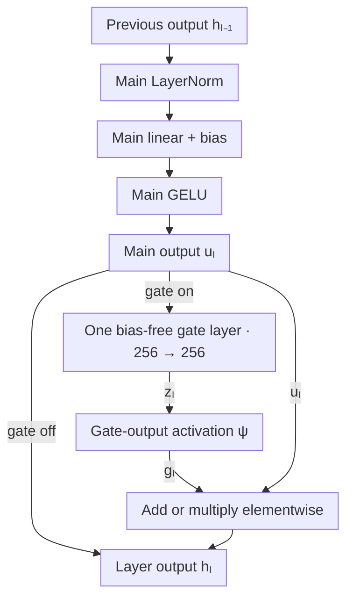

# LIN-001 — Bias-free per-layer gating

## Research question

Does an input-dependent gate at each hidden layer improve a flattened-image MLP enough to justify its added parameters and training time? Compare multiplication and addition across six gate-output activations against a gate-off control.

## Answer

**Yes for optional additive gating on the tested CIFAR-10 recipe. No as a default across datasets.** For CIFAR-10, I consider the observed accuracy gains worth 327,680 extra trainable weights (29.2%) and the longer recorded runtime. CIFAR-100’s qualifying setting remains an experimental candidate given its smaller gain for the same number of extra weights.

For each dataset, we compared twelve fits of the one-layer, bias-free gate with its reused gate-off run. All fits completed 100 epochs. The predeclared rule required a gain of at least 0.5 percentage points in best validation accuracy and a recorded runtime at most 1.5× the control’s.

- **CIFAR-10.** All six additive settings met the rule. `ADDITION/TANH` led at **52.86%** peak validation accuracy versus **50.20%** with gate off (+2.66 points). `ADDITION/DISABLED` gave the largest epoch-100 gain (+1.66 points).
- **CIFAR-100.** `ADDITION/SOFTPLUS` was the sole qualifier at **25.44%** peak validation accuracy versus **24.62%** with gate off (+0.82 points). `ADDITION/TANH` gave the largest epoch-100 gain (+1.32 points).
- **FashionMNIST.** The best peak gain was +0.45 points, below the cutoff. `ADDITION/RELU` gave the largest epoch-100 gain (+1.47 points).
- **MNIST.** The best peak and epoch-100 gains were both +0.27 points. The peak gain fell below the cutoff.

The two CIFAR peak-accuracy leaders also had lower minimum validation loss than their controls. Each setting had one unseeded fit with its own validation split and initialization. Gate-off and gated runs came from separate cohorts, so their recorded runtimes are descriptive.

## Results

Both tables show **validation accuracy (%) / cross-entropy loss**. Bold marks the highest accuracy for each dataset in each table.

### Best validation accuracy and lowest loss

Best accuracy and lowest loss are selected independently across the 100 epochs. **†** marks advancement under the frozen rule.

| Gate / output activation | FashionMNIST | MNIST | CIFAR-10 | CIFAR-100 |
|---|---:|---:|---:|---:|
| Gate off (reused) | 90.3167 / 0.3051 | 98.6000 / 0.0715 | 50.2000 / 1.4702 | 24.6200 / 3.2830 |
| `MULTIPLIER/DISABLED` | 90.5167 / 0.2960 | 98.4333 / 0.0853 | 50.0000 / 1.4716 | 21.4400 / 3.4174 |
| `MULTIPLIER/RELU` | 89.8833 / 0.3128 | 98.5333 / 0.0680 | 48.8400 / 1.5160 | 21.4000 / 3.3864 |
| `MULTIPLIER/SIGMOID` | **90.7667** / 0.2957 | **98.8667** / 0.0705 | 50.3800 / 1.4669 | 24.2400 / 3.3094 |
| `MULTIPLIER/TANH` | 90.6000 / 0.3007 | 98.7333 / 0.0720 | 48.2200 / 1.4885 | 21.8600 / 3.3561 |
| `MULTIPLIER/SOFTPLUS` | 90.7000 / 0.3083 | 98.7333 / 0.0694 | 50.0200 / 1.4918 | 22.7000 / 3.3666 |
| `MULTIPLIER/SOFTSIGN` | 90.1667 / 0.3183 | 98.7333 / 0.0618 | 49.6600 / 1.4840 | 20.9600 / 3.4142 |
| `ADDITION/DISABLED` | 90.5667 / 0.3046 | 98.6333 / 0.0842 | 52.7000† / 1.3941 | 24.8400 / 3.2317 |
| `ADDITION/RELU` | 90.6167 / 0.3039 | 98.5000 / 0.0800 | 50.9400† / 1.4457 | 23.6200 / 3.3063 |
| `ADDITION/SIGMOID` | 90.4833 / 0.3038 | 98.7000 / 0.0798 | 50.9800† / 1.4461 | 24.6800 / 3.2252 |
| `ADDITION/TANH` | 90.4167 / 0.2999 | 98.4000 / 0.0812 | **52.8600**† / 1.3834 | 24.5400 / 3.2265 |
| `ADDITION/SOFTPLUS` | 90.1333 / 0.3062 | **98.8667** / 0.0601 | 51.7400† / 1.4228 | **25.4400**† / 3.2459 |
| `ADDITION/SOFTSIGN` | 90.5000 / 0.3091 | 98.5667 / 0.0803 | 51.4800† / 1.4318 | 24.6000 / 3.2327 |

### Validation accuracy and loss at epoch 100

| Gate / output activation | FashionMNIST | MNIST | CIFAR-10 | CIFAR-100 |
|---|---:|---:|---:|---:|
| Gate off (reused) | 89.0833 / 0.6782 | 98.5000 / 0.1426 | 50.1400 / 5.1258 | 21.2000 / 10.3052 |
| `MULTIPLIER/DISABLED` | 90.2000 / 0.6206 | 98.3667 / 0.1769 | 49.9400 / 4.2934 | 20.4200 / 10.8877 |
| `MULTIPLIER/RELU` | 89.1667 / 0.7073 | 98.5333 / 0.1841 | 48.2000 / 4.4703 | 19.1000 / 10.8809 |
| `MULTIPLIER/SIGMOID` | 89.4000 / 0.5703 | **98.7667** / 0.1150 | 49.2200 / 5.0260 | 21.5600 / 10.1486 |
| `MULTIPLIER/TANH` | 89.3000 / 0.5798 | 98.5333 / 0.1199 | 47.2600 / 4.5007 | 18.6200 / 9.0996 |
| `MULTIPLIER/SOFTPLUS` | 89.9667 / 0.5941 | 98.6333 / 0.1445 | 49.1400 / 4.9896 | 20.4800 / 11.3554 |
| `MULTIPLIER/SOFTSIGN` | 89.6833 / 0.6983 | 97.9000 / 0.1069 | 48.6800 / 4.4206 | 18.6800 / 9.6464 |
| `ADDITION/DISABLED` | 89.9000 / 0.6045 | 98.3333 / 0.1341 | **51.8000** / 4.1866 | 21.9000 / 9.4932 |
| `ADDITION/RELU` | **90.5500** / 0.5199 | 98.4333 / 0.1632 | 49.0600 / 4.5981 | 21.4600 / 9.8850 |
| `ADDITION/SIGMOID` | 89.8000 / 0.5628 | 98.6000 / 0.0953 | 49.7800 / 4.8638 | 22.3200 / 9.8682 |
| `ADDITION/TANH` | 89.4667 / 0.5992 | 98.0667 / 0.1386 | 51.2200 / 4.3513 | **22.5200** / 9.1421 |
| `ADDITION/SOFTPLUS` | 89.6833 / 0.5666 | 98.1333 / 0.1087 | 50.5800 / 4.6496 | 22.0600 / 10.1410 |
| `ADDITION/SOFTSIGN` | 89.7667 / 0.6063 | 98.5667 / 0.1164 | 50.8600 / 4.6348 | 21.5200 / 9.4070 |

## Method

The `linears/linear` classifier flattens the image, projects it to 256 features, runs the main hidden stack, then projects to class logits. A gated fit uses **one gate controller per main hidden layer**. That gives three controllers on MNIST and five on FashionMNIST, CIFAR-10 and CIFAR-100.



**1. Compute the main output.** At layer $\ell$, start with the previous output $h_{\ell-1}$. At the first layer this is the input projection's output. Apply LayerNorm, the main weights $W_\ell$ and bias $b_\ell$, then GELU.

$$
n_\ell=\operatorname{LN}(h_{\ell-1}),\qquad
a_\ell=W_\ell n_\ell+b_\ell,\qquad
u_\ell=\operatorname{GELU}(a_\ell).
$$

**2. Compute the gate values.** Feed the 256 post-GELU features into one bias-free linear layer with matrix $A_\ell\in\mathbb{R}^{256\times256}$. Each row reads all 256 features to produce one raw gate value. Apply the selected activation $\psi$ to each raw value.

$$
z_\ell=A_\ell u_\ell,\qquad
z_{\ell,i}=\sum_{j=1}^{256}(A_\ell)_{ij}\,u_{\ell,j},\qquad
g_\ell=\psi(z_\ell).
$$

Each $A_\ell$ adds $256^2=65{,}536$ trainable weights. Controller normalization and postprocessing are disabled. The gate-output activation runs separately, with $g_\ell=z_\ell$ when it is `DISABLED`. With `--gate-stack-independent-flag false`, each gate uses the shared submodule configuration and has its own weight matrix. The single layer's input and output widths determine its shape, so the intermediate hidden-width override was removed.

**3. Form the layer output.** Addition adds each gate value to its matching feature. Multiplication scales each feature by its gate value. The resulting $h_\ell$ goes to the next main layer or, at the end of the stack, the classifier head.

$$
h_\ell=
\begin{cases}
u_\ell & \text{gate off},\\
u_\ell+g_\ell & \text{ADDITION},\\
u_\ell\odot g_\ell & \text{MULTIPLIER}.
\end{cases}
$$

## Experimental setup

All fits use cross-entropy, batch size 128, Adam at the listed learning rate, and 100 epochs with early stopping disabled. Images are resized, converted to tensors and normalized. Training shuffles and drops the final partial batch. Validation uses the full held-out split.

| Dataset | Resize / classes | Train / validation | Main depth / Adam rate | Normalization mean / std |
|---|---|---|---|---|
| FashionMNIST | 28×28 / 10 | 54,000 / 6,000 | 5 / 0.001 | 0.2860 / 0.3530 |
| MNIST | 28×28 / 10 | 57,000 / 3,000 | 3 / 0.001 | 0.1307 / 0.3081 |
| CIFAR-10 | 32×32 / 10 | 45,000 / 5,000 | 5 / 0.0003 | (0.4914, 0.4822, 0.4465) / (0.2470, 0.2435, 0.2616) |
| CIFAR-100 | 32×32 / 100 | 45,000 / 5,000 | 5 / 0.0003 | (0.5071, 0.4865, 0.4409) / (0.2673, 0.2564, 0.2761) |

CIFAR-100 applies a training-only horizontal flip with probability 0.5. Every setting has one independently realized unseeded split and initialization. The reported scores describe validation performance within these recipes. Each comparison uses the original gate-off observation and recorded command duration from its separate cohort, with execution conditions uncontrolled. Peak memory is a child-process high-water mark that can include earlier peaks.

## Reproduction

Run one command per dataset from the pinned Emperor checkout. All four use a width-256 main stack with one bias-free 256→256 gate layer per main hidden layer. Each grid crosses addition and multiplication with six gate-output settings for twelve 100-epoch fits. The comparison reuses the gate-off results above. [Pinned Emperor source](https://github.com/InkRavenMedia/emperor/tree/181bfd80f0e7a424dcb559a0022b9b9442bb0db4)

### FashionMNIST

The classifier uses **5 main hidden layers** and **Adam at `0.001`** to classify 28×28 grayscale images into 10 clothing and accessory categories.

```bash
mise run experiment -- \
  --model-type linears \
  --model linear \
  --preset gating \
  --datasets fashion-mnist \
  --grid-search \
  --search-set gate_option=MULTIPLIER,ADDITION \
  --search-set gate_activation=DISABLED,RELU,SIGMOID,TANH,SOFTPLUS,SOFTSIGN \
  --monitors layer-controller \
  --config \
  --num-epochs 100 \
  --batch-size 128 \
  --hidden-dim 256 \
  --stack-num-layers 5 \
  --learning-rate 0.001 \
  --normalization LAYER_NORM \
  --submodule-stack-num-layers 1 \
  --submodule-stack-bias-flag false \
  --submodule-stack-layer-norm-position DISABLED \
  --submodule-stack-apply-output-postprocessing-flag false \
  --gate-stack-independent-flag false \
  --callback-early-stopping-patience 0 \
  --run-test-after-fit false \
  --trainer-accelerator cpu \
  --trainer-precision 32-true \
  --trainer-benchmark false \
  --trainer-num-sanity-val-steps 0 \
  --trainer-enable-checkpointing true \
  --callback-checkpoint-flag true \
  --trainer-max-time 00:11:00:00
```

### MNIST

The classifier uses **3 main hidden layers** and **Adam at `0.001`** to classify 28×28 grayscale images into 10 digit classes.

```bash
mise run experiment -- \
  --model-type linears \
  --model linear \
  --preset gating \
  --datasets mnist \
  --grid-search \
  --search-set gate_option=MULTIPLIER,ADDITION \
  --search-set gate_activation=DISABLED,RELU,SIGMOID,TANH,SOFTPLUS,SOFTSIGN \
  --monitors layer-controller \
  --config \
  --num-epochs 100 \
  --batch-size 128 \
  --hidden-dim 256 \
  --stack-num-layers 3 \
  --learning-rate 0.001 \
  --normalization LAYER_NORM \
  --submodule-stack-num-layers 1 \
  --submodule-stack-bias-flag false \
  --submodule-stack-layer-norm-position DISABLED \
  --submodule-stack-apply-output-postprocessing-flag false \
  --gate-stack-independent-flag false \
  --callback-early-stopping-patience 0 \
  --run-test-after-fit false \
  --trainer-accelerator cpu \
  --trainer-precision 32-true \
  --trainer-benchmark false \
  --trainer-num-sanity-val-steps 0 \
  --trainer-enable-checkpointing true \
  --callback-checkpoint-flag true \
  --trainer-max-time 00:11:00:00
```

### CIFAR-10

The classifier uses **5 main hidden layers** and **Adam at `0.0003`** to classify 32×32 RGB images into 10 classes.

```bash
mise run experiment -- \
  --model-type linears \
  --model linear \
  --preset gating \
  --datasets cifar10 \
  --grid-search \
  --search-set gate_option=MULTIPLIER,ADDITION \
  --search-set gate_activation=DISABLED,RELU,SIGMOID,TANH,SOFTPLUS,SOFTSIGN \
  --monitors layer-controller \
  --config \
  --num-epochs 100 \
  --batch-size 128 \
  --hidden-dim 256 \
  --stack-num-layers 5 \
  --learning-rate 0.0003 \
  --normalization LAYER_NORM \
  --submodule-stack-num-layers 1 \
  --submodule-stack-bias-flag false \
  --submodule-stack-layer-norm-position DISABLED \
  --submodule-stack-apply-output-postprocessing-flag false \
  --gate-stack-independent-flag false \
  --callback-early-stopping-patience 0 \
  --run-test-after-fit false \
  --trainer-accelerator cpu \
  --trainer-precision 32-true \
  --trainer-benchmark false \
  --trainer-num-sanity-val-steps 0 \
  --trainer-enable-checkpointing true \
  --callback-checkpoint-flag true \
  --trainer-max-time 00:11:00:00
```

### CIFAR-100

The classifier uses **5 main hidden layers** and **Adam at `0.0003`** to classify 32×32 RGB images into 100 classes. Training flips images horizontally with 50% probability.

```bash
mise run experiment -- \
  --model-type linears \
  --model linear \
  --preset gating \
  --datasets cifar100 \
  --grid-search \
  --search-set gate_option=MULTIPLIER,ADDITION \
  --search-set gate_activation=DISABLED,RELU,SIGMOID,TANH,SOFTPLUS,SOFTSIGN \
  --monitors layer-controller \
  --config \
  --num-epochs 100 \
  --batch-size 128 \
  --hidden-dim 256 \
  --stack-num-layers 5 \
  --learning-rate 0.0003 \
  --normalization LAYER_NORM \
  --submodule-stack-num-layers 1 \
  --submodule-stack-bias-flag false \
  --submodule-stack-layer-norm-position DISABLED \
  --submodule-stack-apply-output-postprocessing-flag false \
  --gate-stack-independent-flag false \
  --callback-early-stopping-patience 0 \
  --run-test-after-fit false \
  --trainer-accelerator cpu \
  --trainer-precision 32-true \
  --trainer-benchmark false \
  --trainer-num-sanity-val-steps 0 \
  --trainer-enable-checkpointing true \
  --callback-checkpoint-flag true \
  --trainer-max-time 00:11:00:00
```

## Supplementary evidence

The Study records the four Comparisons, and the dataset notes link to full metrics, learning curves and both checkpoints per fit. Historical gated scores retain their original provenance.

[Canonical Study](../../005_research_wiki/experiments/studies/lin-001-per-layer-gating.md) · [FashionMNIST](../../005_research_wiki/wiki/sources/lin-001-bias-free-fashionmnist-results.md) · [MNIST](../../005_research_wiki/wiki/sources/lin-001-bias-free-mnist-results.md) · [CIFAR-10](../../005_research_wiki/wiki/sources/lin-001-bias-free-cifar10-results.md) · [CIFAR-100](../../005_research_wiki/wiki/sources/lin-001-bias-free-cifar100-results.md)
